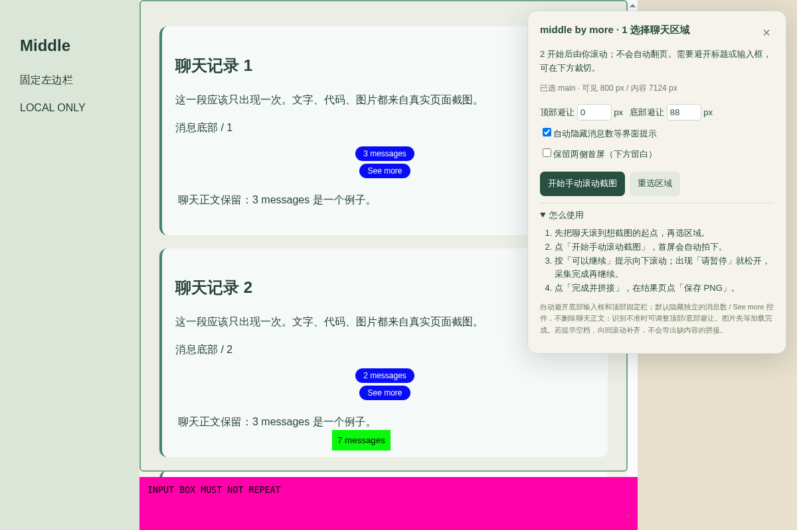

# middle by more

Chrome 中间聊天区长截图扩展。保留两侧边栏首屏，由你滚动、扩展提示暂停/继续并拼接；本机处理，MIT 开源。

以下为 0.4.0 使用说明。截图仅为本地测试页面，不是真实用户聊天或 Mac 实机测试。

由你手动滚动聊天区，扩展分段采集。看到橙色「请暂停」就松开滚轮；保存成功后显示绿色「已抓好，可以继续向下滚动」。只有点「完成并拼接」才结束。

## 安装或更新

1. 解压 `middle-by-more-0.4.0.zip`。
2. Chrome 打开 `chrome://extensions`，开启「开发者模式」。
3. 删除旧版 Middle，再点「加载已解压的扩展程序」，选择解压后直接含有 `manifest.json` 的文件夹。新版清单文件已放在包的根目录，不需要再找 `extension` 子文件夹。
4. 刷新要截图的聊天网页，点击 Chrome 工具栏的 middle by more（找不到时从拼图图标里打开）。

## 截一张长图

1. 先把聊天滚到想保留的起点；此处就是长图开头，不会自动回顶部。
2. 点 middle by more →「选择截图区域」。鼠标移到真正滚动的聊天记录上，确认绿色框只框中间内容，再点击。选错了点「重选区域」。
3. 扩展自动识别底部输入框、顶部固定栏并填写「顶部避让 / 底部避让」；绿色框显示实际采集范围。开始前可手动调整。拍摄瞬间会隐藏重叠的固定/吸顶小浮层，拍完恢复；输入框和跳转提示不再逐屏拼入。
4. 点「开始手动滚动截图」。看到绿色「已抓好，可以继续向下滚动」后向下滚；看到橙色「请暂停」就松开。扩展会停在保留重叠的安全位置、临时锁定滚动并采集，成功后再提示继续。滚得很快或按翻页时也会限制单段距离，减少漏接。采集瞬间控制面板会短暂隐藏，避免被拍进去；恢复绿色提示后再滚。
5. 到想结束的位置后，停稳，点「完成并拼接」（或按 Esc）。在新打开的结果页检查拼接，再点「保存 PNG」。

## 其他操作

- 「暂停采集 / 继续采集」：中途休息时用。暂停保留已拍内容并锁定位置；点继续后会确认当前屏，再恢复滚动。
- 「补拍当前屏」：当前屏的图片加载好了、或刚才截图失败时使用。相同位置以最后一张为准。
- 提示「空档」：页面动态加载或位置变化可能打断接续。往回慢滚到漏掉的区间，仍按半屏停一秒补拍。拼接会按位置排序；有空档时不会输出缺内容的长图。
- 「放弃本次」：删除当前采集的数据，重新选区域开始。
- 「保留两侧首屏」：结果图左右保留第一屏的侧栏，侧栏以下浅色留白，不重复、不拉伸。取消勾选则只输出中间聊天区；结果页也可切换。
- 「清除本次截图」：删除扩展本机的这次采集数据。请先保存 PNG；清除不会删除已下载的 PNG。

## 自动清理界面提示

默认勾选「自动隐藏消息数等界面提示」。采集每屏时，识别小型独立控件的完整标签，例如 `3 messages`、`2 messages`、`See more`、`查看更多`、`3 条消息`；即使控件不是 fixed/sticky 也会临时隐藏。拍完立即恢复，不点击、不展开、不删网页内容。使用 visibility 隐藏而不压缩原布局，避免滚动坐标变化，因此原控件所在位置可能留白。动态新增的控件会在下一屏重新检测。

这是本机 DOM 规则，不是 AI/OCR：不修改图片中的文字；聊天正文中提到 `3 messages` 不会因此被删掉。仅针对紧凑、有交互特征的独立控件；不保证所有网站都识别。需要保留消息展开/导航控件时，可在开始前取消勾选。

## 拍摄时注意

- 保持该标签页、该 Chrome 窗口在前台；不要切换标签页、调整窗口尺寸或缩放。
- 等图片加载后再滚动；扩展会短暂等待可见图片，失败时会提示补拍，不保证所有网站的懒加载图片都会自动完成。
- 本版按滚动位置拼接，适合内容位置稳定的滚动容器。自动避让基于页面结构和位置启发式识别，不保证所有网站识别准确。尚未验证你使用的聊天网站及 Mac。虚拟列表、向上加载旧消息后内容重排、动画、视频、持续新增消息，可能造成重叠或错位；先加载好所需记录，再从上向下分段拍摄更稳妥。
- 每次最多 100 屏；很长的图会自动分成多张 PNG，浏览器可能询问是否允许多文件下载。
- Chrome 内置页面、扩展商店等受保护页面不能注入。普通网页可选择实际滚动的区域；跨域 iframe / 封闭组件未做适配。

## 数据

没有上传或账号服务。截图保存在本机扩展的 IndexedDB；点「完成并拼接」只生成预览，必须再点「保存 PNG」才会下载。用完可在结果页清除本次数据。

## 开发与开源

MIT License。源码无需构建即可加载；`pnpm install --frozen-lockfile && pnpm test` 运行纯逻辑测试。浏览器集成测试见 TEST-REPORT.md。不包含真实聊天截图、账号信息或密钥。
